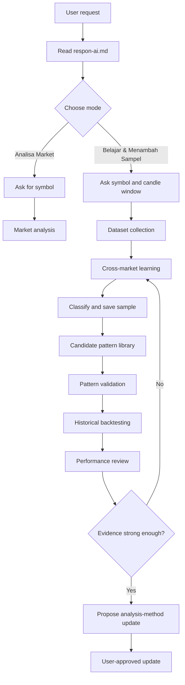

# Market Research & Trading Analysis Skills

<p align="center">
  <strong>A structured, evidence-first framework for studying crypto markets.</strong>
</p>

<p align="center">
  
  
  
  
</p>

A modular collection of research workflows for analyzing historical crypto market behavior, discovering recurring patterns, validating hypotheses, and translating approved evidence into disciplined trade plans.

The central idea is simple: **study the data, test the pattern, keep the counterexamples, and only then update the analysis method.**

## Start here — AI interaction rules

Before handling a new request, the AI must read **[respon-ai.md](respon-ai.md)**. It defines the first question, routes the user into the correct mode, and sets the rules for saving and counting research samples.

The two modes are separate:

- **Analisa Market** — ask for the market symbol and analyze it. This does not automatically create a research sample.
- **Belajar & Menambah Sampel** — ask for symbol, start candle, end candle, timeframe, and timezone when needed. Compare the result with existing samples and save the completed research record to GitHub.

## Research scope

The core market-analysis dataset is intentionally focused on three observable inputs:

- **Price** — OHLC, returns, ranges, and market structure.
- **Volume** — trading activity compared with the same asset's historical baseline.
- **Open Interest (OI)** — outstanding contracts and changes over time.

Additional indicators are not automatically accepted. Candidate indicators must demonstrate that they add useful information through the learning and validation workflow.

## Documentation

### Core workflow

| Document | Purpose |
|---|---|
| [AI Response Workflow](respon-ai.md) | Mandatory entry point for user intent, mode selection, data requests, and sample-counting rules |
| [Market Analysis](skills/skill-analisa.md) | Analyze a specific market and time window using approved inputs |
| [Market Learning](skills/skill-learning.md) | Discover similarities and recurring sequences across markets |
| [Pattern Validation](skills/skill-validation.md) | Test hypotheses against independent samples and counterexamples |
| [Historical Backtesting](skills/skill-backtesting.md) | Simulate fixed rules chronologically on historical data |
| [Pattern Library](skills/skill-pattern-library.md) | Preserve pattern definitions, evidence, versions, and status |
| [Dataset Standard](skills/skill-dataset.md) | Standardize raw observations, timestamps, units, and provenance |
| [Market Classification](skills/skill-market-classification.md) | Label observable market states without inferring participant intent |
| [Performance Review](skills/skill-performance-review.md) | Review research quality, evidence strength, and methodology changes |
| [Trade Planning](skills/skill-planing.md) | Define entry, stop-loss, targets, and order cancellation conditions when requested |

### Supporting resources

- [Research workflow](docs/WORKFLOW.md)
- [Sample dataset template](templates/sample-record.md)
- [Research records](research/README.md)

## How the system works



The workflow is iterative. A new market can support an existing pattern, contradict it, or reveal a new candidate. No pattern or indicator is promoted automatically.

## Guiding principles

1. **Evidence before narrative.** Report observed values separately from interpretations.
2. **Counterexamples matter.** Failed patterns are retained, not hidden.
3. **No look-ahead.** A historical signal may only use information available at its timestamp.
4. **Independent testing.** Discovery samples and validation samples must be separated.
5. **Comparable data.** Keep units, timeframes, timestamp alignment, and baselines explicit.
6. **No unsupported participant claims.** Price, volume, and OI do not identify who traded or why.
7. **No automatic indicator creep.** New indicators require a clear definition and evidence of added value.
8. **Research is not a guarantee.** A validated historical pattern is not proof of future performance or profitability.
9. **Pattern-specific counting.** A market sample only counts toward a pattern target when it matches that pattern's written definition. Different patterns must never be combined to reach 10 samples.

## Current research status

Research samples are stored independently, even when they show different behaviors. Each sample is classified as supporting a candidate pattern, contradicting it, showing a different candidate, or insufficiently clear.

The target of 10 applies to **comparable samples for one specific pattern**, not to the total number of markets studied. Ten samples are an initial research threshold, not statistical proof or automatic validation. See [respon-ai.md](respon-ai.md) for the full counting rules.

## Repository structure

```text
.
├── README.md
├── respon-ai.md
├── CONTRIBUTING.md
├── docs/
│   └── WORKFLOW.md
├── skills/
│   ├── skill-analisa.md
│   ├── skill-backtesting.md
│   ├── skill-dataset.md
│   ├── skill-learning.md
│   ├── skill-market-classification.md
│   ├── skill-pattern-library.md
│   ├── skill-performance-review.md
│   ├── skill-planing.md
│   └── skill-validation.md
├── templates/
│   └── sample-record.md
└── research/
    ├── samples/
    ├── patterns/
    ├── validation/
    ├── backtests/
    └── reviews/
```

## Getting started

1. Read [respon-ai.md](respon-ai.md) to identify the user's intent and select the correct mode.
2. For market analysis, request the symbol and follow the analysis skill.
3. For learning, request the symbol, exact candle start/end, timeframe, and timezone.
4. Use the dataset standard to capture the historical market sample.
5. Compare the sample with existing patterns and retain counterexamples.
6. Save every completed learning sample to its own research record.
7. Count samples only within their matching pattern group.
8. Validate a fixed hypothesis on independent data.
9. Propose changes to the analysis method only when evidence supports them.

## Scope and disclaimer

This repository documents research methods and analytical workflows. It does not provide guaranteed trading signals, financial advice, exchange execution, or proof of market manipulation. Historical relationships can fail in future market conditions. Always verify source data and apply independent risk management.

## Contributing

Improvements should include clear definitions, reproducible calculations, data provenance, and counterexample handling. Do not submit unsupported claims or cherry-picked results. See [CONTRIBUTING.md](CONTRIBUTING.md) and the [research workflow](docs/WORKFLOW.md) before proposing changes.
