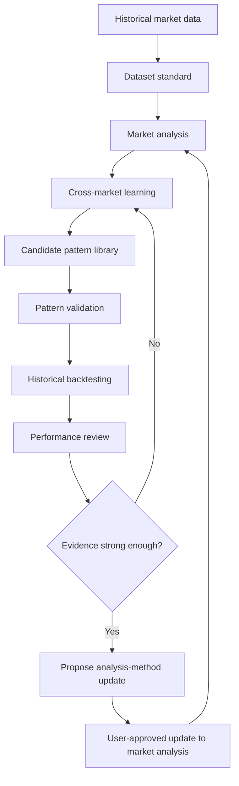

# Market Research & Trading Analysis Skills

<p align="center">
  <strong>A structured, evidence-first framework for studying crypto markets.</strong>
</p>

<p align="center">
  
  
  
  
</p>

A modular collection of research workflows for analyzing historical crypto market behavior, discovering recurring patterns, validating hypotheses, and translating approved evidence into disciplined trade plans.

The central idea is simple: **study the data, test the pattern, keep the counterexamples, and only then update the analysis method.**

## Research scope

The core market-analysis dataset is intentionally focused on three observable inputs:

- **Price** — OHLC, returns, ranges, and market structure.
- **Volume** — trading activity compared with the same asset's historical baseline.
- **Open Interest (OI)** — outstanding contracts and changes over time.

Additional indicators are not automatically accepted. Candidate indicators must demonstrate that they add useful information through the learning and validation workflow.

## Documentation

### Core workflow

| Document | Purpose |
|---|---|
| [Market Analysis](skills/skill-analisa.md) | Analyze a specific market and time window using approved inputs |
| [Market Learning](skills/skill-learning.md) | Discover similarities and recurring sequences across markets |
| [Pattern Validation](skills/skill-validation.md) | Test hypotheses against independent samples and counterexamples |
| [Historical Backtesting](skills/skill-backtesting.md) | Simulate fixed rules chronologically on historical data |
| [Pattern Library](skills/skill-pattern-library.md) | Preserve pattern definitions, evidence, versions, and status |
| [Dataset Standard](skills/skill-dataset.md) | Standardize raw observations, timestamps, units, and provenance |
| [Market Classification](skills/skill-market-classification.md) | Label observable market states without inferring participant intent |
| [Performance Review](skills/skill-performance-review.md) | Review research quality, evidence strength, and methodology changes |
| [Trade Planning](skills/skill-planing.md) | Define entry, stop-loss, targets, and order cancellation conditions when requested |

### Supporting resources

- [Research workflow](docs/WORKFLOW.md)
- [Sample dataset template](templates/sample-record.md)
- [Research records](research/README.md)

## How the system works



The workflow is iterative. A new market can support an existing pattern, contradict it, or reveal a new candidate. No pattern or indicator is promoted automatically.

## Guiding principles

1. **Evidence before narrative.** Report observed values separately from interpretations.
2. **Counterexamples matter.** Failed patterns are retained, not hidden.
3. **No look-ahead.** A historical signal may only use information available at its timestamp.
4. **Independent testing.** Discovery samples and validation samples must be separated.
5. **Comparable data.** Keep units, timeframes, timestamp alignment, and baselines explicit.
6. **No unsupported participant claims.** Price, volume, and OI do not identify who traded or why.
7. **No automatic indicator creep.** New indicators require a clear definition and evidence of added value.
8. **Research is not a guarantee.** A validated historical pattern is not proof of future performance or profitability.

## Current research hypothesis

The initial three reviewed samples — INITUSDT, PIEVERSEUSDT, and EDGEUSDT — showed a provisional relationship where OI increased alongside price and volume expansion.

This is a starting hypothesis, not a validated signal. New samples must test it, including cases where:
- Price and volume expand without OI increasing.
- OI and volume increase while price remains range-bound.
- OI increases only after most of the price move has occurred.

## Repository structure

```text
.
├── README.md
├── docs/
│   └── WORKFLOW.md
├── skills/
│   ├── skill-analisa.md
│   ├── skill-backtesting.md
│   ├── skill-dataset.md
│   ├── skill-learning.md
│   ├── skill-market-classification.md
│   ├── skill-pattern-library.md
│   ├── skill-performance-review.md
│   ├── skill-planing.md
│   └── skill-validation.md
├── templates/
│   └── sample-record.md
└── research/
    └── README.md
```

## Getting started

1. Read the [research workflow](docs/WORKFLOW.md).
2. Use the dataset standard to capture a historical market sample.
3. Analyze the exact symbol, contract, timeframe, and date window.
4. Compare the sample with existing patterns.
5. Record both supporting evidence and counterexamples.
6. Validate a fixed hypothesis on independent data.
7. Backtest only after the rule and evaluation criteria are defined.
8. Propose changes to the analysis method only when evidence supports them.

## Scope and disclaimer

This repository documents research methods and analytical workflows. It does not provide guaranteed trading signals, financial advice, exchange execution, or proof of market manipulation. Historical relationships can fail in future market conditions. Always verify source data and apply independent risk management.

## Contributing

Improvements should include clear definitions, reproducible calculations, data provenance, and counterexample handling. Do not submit unsupported claims or cherry-picked results. See [CONTRIBUTING.md](CONTRIBUTING.md) and the [research workflow](docs/WORKFLOW.md) before proposing changes.
